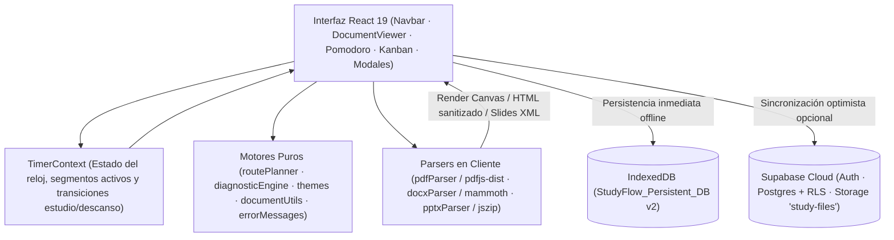

# Arquitectura e Ingeniería — StudyFlow 2.0

Este documento detalla las decisiones de diseño, arquitectura de datos, algoritmos centrales, medidas de seguridad y estrategia de pruebas de **StudyFlow 2.0**. Está orientado a desarrolladores, revisores técnicos y fines de portafolio.

---

## 1. Principios de Diseño

1. **Local-First con Cero Fricción**: Toda la experiencia principal (carga de archivos binarios, lectura, post-its, planificación y Pomodoro) funciona 100 % en el navegador sobre **IndexedDB** sin requerir backend ni login obligatorio.
2. **Sincronización Optimista Multi-Dispositivo**: Cuando existen credenciales públicas de Supabase configuradas, la app habilita autenticación por usuario y sincroniza metadatos, configuraciones, rutas y binarios en **PostgreSQL + Storage** respetando aislamiento estricto por **Row Level Security (RLS)**.
3. **Motores de Dominio Puros y Desacoplados**: La lógica de planificación de rutas, calibración diagnóstica, paginación virtual, cálculo de márgenes responsivos y traducción de errores reside en módulos TypeScript puros bajo `src/lib/` sin acoplamiento al DOM de React, facilitando pruebas unitarias rápidas con **Vitest**.
4. **Estética Personalizable en Runtime**: Todos los tokens de color, acentos, fondos y tipografía se propagan mediante **CSS Custom Properties** (`--sf-*`), evitando recompilaciones de Tailwind o desfase en builds de producción.

---

## 2. Diagrama de Arquitectura

---

## 3. Subsistemas Clave

### 3.1. Procesamiento Multi-Formato 100 % en Cliente

Ningún archivo requiere conversión en un servidor externo para ser visualizado:

* **PDF (`src/lib/pdfParser.ts` + `DocumentViewer.tsx`)**: Renderiza páginas sobre `<canvas>` mediante `pdfjs-dist` usando `scale = zoom` calculado dinámicamente al viewport útil. Cancela tareas de render en vuelo (`RenderTask.cancel()`) al cambiar rápido de página o zoom.
* **DOCX (`src/lib/docxParser.ts`)**: Convierte documentos con `mammoth` y aplica **paginación virtual** (`paginateDocxHtml`) respetando saltos explícitos (`studyflow-page-break`) o peso de caracteres/imágenes, junto con **sanitización del árbol DOM** (`sanitizeNodeTree`, eliminando etiquetas ejecutables como `<script>`, `<iframe>` y atributos `on*` / `javascript:`).
* **PPTX (`src/lib/pptxParser.ts`)**: Descomprime el archivo OOXML con `jszip`, resuelve relaciones de slides y notas del orador (`notesSlides`), y reconstruye formas, tipografías y colores desde `DrawingML` XML.
* **Exportación (`src/lib/pdfExport.ts`)**: Compila apuntes filtrados de la pizarra Kanban en un documento PDF multipágina estructurado usando `jsPDF`.

### 3.2. Planificador Secuencial de Rutas (`src/lib/routePlanner.ts`)

`generateStudyRoute` transforma un conjunto ordenado de documentos, páginas pendientes y una fecha límite (`deadline`) en bloques diarios accionables:

* **Estrategias de asignación**:
  * `pack`: empaqueta documentos cortos consecutivos dentro del mismo bloque Pomodoro/páginas para no desperdiciar ciclos en lecturas breves, generando segmentos trazables por documento (`RouteSegment`).
  * `exact_doc`: ajusta cada etapa al tiempo estimado del archivo.
  * `full_block`: garantiza un bloque mínimo completo por documento.
* **Reglas de descanso y viabilidad**: inserta descansos largos al cambiar de archivo si `longBreakBetweenDocs` está activo o cada *N* bloques, calcula días disponibles hasta `deadline` y clasifica el plan como `optimal`, `tight` u `overloaded`.

### 3.3. Motor de Diagnóstico Lector (`src/lib/diagnosticEngine.ts`)

Permite calibrar la velocidad lectora real sin formularios subjetivos:

* **Filtrado anti-ruido**: solo registra/acumula tiempo activo de lectura cuando hay interacción reciente (control AFK en `DocumentViewer.tsx`) e ignora micro-visitas menores a `MIN_VALID_SAMPLE_SECONDS = 3` segundos al crear muestras nuevas.
* **Recomendación estadística**: calcula percentiles de tiempo por página, clasifica la densidad del material (`light`, `standard`, `dense`) y sugiere duración de estudio, descansos y páginas estimadas por bloque.

### 3.4. Visor Adaptativo y Estabilidad Táctil (`DocumentViewer.tsx` + `documentUtils.ts`)

Para ofrecer lectura cómoda tanto en **PC** como en **iPad / tablet**:

* `computeStageHorizontalMargins` inspecciona las notas visibles de la hoja actual (o doble hoja en modo libro). Cuando no hay post-its sobresaliendo hacia los márgenes externos ni está abierto el modo de colocación/arrastre, colapsa los márgenes laterales del escenario a **`0 px`**.
* Un `ResizeObserver` continuo ajusta el zoom al ancho útil al abrir archivos, colapsar la barra lateral o rotar la tablet (respetando zoom manual explícito del usuario).
* Cuando el contenido cabe horizontalmente y no hay notas externas, el contenedor aplica `overflow-x-hidden touch-pan-y overscroll-x-none`, impidiendo el desplazamiento lateral involuntario al hacer scroll táctil.
* Al iniciar arrastre de una nota o activar `"Pegar Nota"`, un anclaje en `useLayoutEffect` compensa el `scrollLeft` por la diferencia exacta de posición de la hoja para evitar saltos visuales bajo el cursor o dedo.

### 3.5. Sistema de Temas Dinámicos (`src/lib/themes.ts` + `src/theme-overrides.css`)

* Define **9 temas base** (7 oscuros y 2 claros), **8 escalas de acento**, **7 fondos ambientales** + carga de imagen personalizada comprimida en Canvas (`compressWallpaperImage`), **3 tonos de papel**, tipografías y escala UI.
* `buildCustomAccentScale` genera en tiempo real las 11 tonalidades RGB (`50`–`950`) desde cualquier color hexadecimal elegido por el usuario, garantizando contraste legible tanto en temas claros como oscuros.
* Las reglas `@media` en `src/index.css` adaptan automáticamente la escala base de interfaz en tablet (`<= 1180px`) y móvil (`<= 639px`) sin alterar la vista desktop.

### 3.6. Capa Offline, Nube y Seguridad

* **IndexedDB (`src/lib/localDb.ts`)**: almacena `folders`, `documents` (incluyendo `ArrayBuffer` para disponibilidad offline), `notes`, `tasks` y `settings`.
* **Supabase (`supabase/schema.sql`, `src/lib/cloudSync.ts`)**:
  * Tablas: `profiles`, `folders`, `documents`, `notes`, `tasks`, `study_plans`.
  * **Seguridad RLS**: cada tabla habilita políticas estrictas por `auth.uid() = user_id` (`auth.uid() = id` en `profiles`), asegurando aislamiento multi-estudiante.
  * **Storage privado**: los binarios se almacenan en el bucket `study-files` bajo rutas con prefijo `<user_id>/...`.
  * **Traducción de errores (`src/lib/errorMessages.ts`)**: normaliza códigos de Supabase Auth, PostgREST, Storage, fallos de red y parsers al español.
* **Protección de secretos en build (`vite.config.ts`)**: utiliza `loadEnv` y `define` para exponer únicamente las variables públicas necesarias (`SUPABASE_URL`, `SUPABASE_PUBLISHABLE_KEY`, `SUPABASE_ANON_KEY`, con o sin prefijo `VITE_` / `NEXT_PUBLIC_`), evitando incluir nunca variables privadas del servidor (como `SUPABASE_SERVICE_ROLE_KEY`) en el bundle cliente.

---

## 4. Estrategia de Pruebas (`Vitest`)

Ejecutar con `npm test` (validación adicional de tipos y empaquetado con `npm run build` / `tsc -b && vite build`):

| Archivo de prueba | Cobertura |
| :--- | :--- |
| `src/lib/__tests__/diagnosticEngine.test.ts` | Acumulación de muestras, filtrado `< 3s` y recomendación de ciclos Pomodoro |
| `src/lib/__tests__/routePlanner.test.ts` | Generación secuencial de bloques, empaquetado de documentos, descansos y viabilidad |
| `src/lib/__tests__/documentSupport.test.ts` | Detección de formatos, rechazo de binarios legacy, parseo OOXML `.pptx` y márgenes adaptativos |
| `src/lib/__tests__/themes.test.ts` | Integridad de escalas de acento, custom hex RGB, defaults y propagación de variables CSS |
| `src/lib/__tests__/errorMessages.test.ts` | Traducción al español de errores Supabase Auth, Postgres/RLS, red y parsers PDF |

